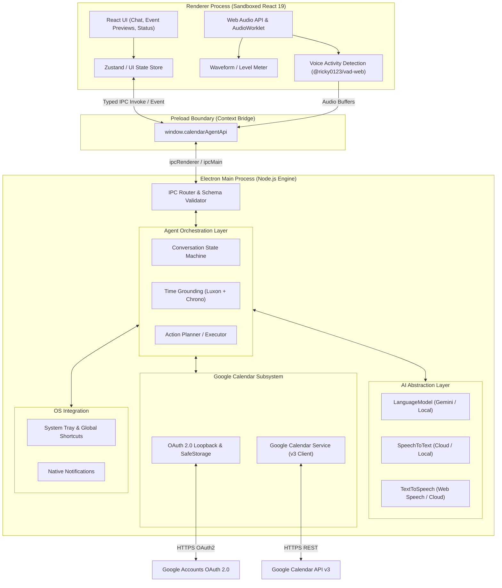
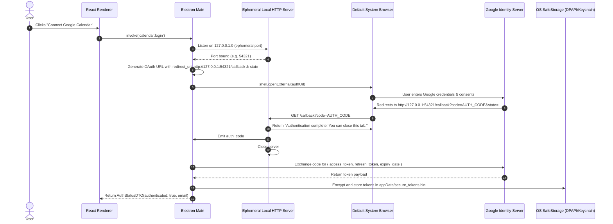
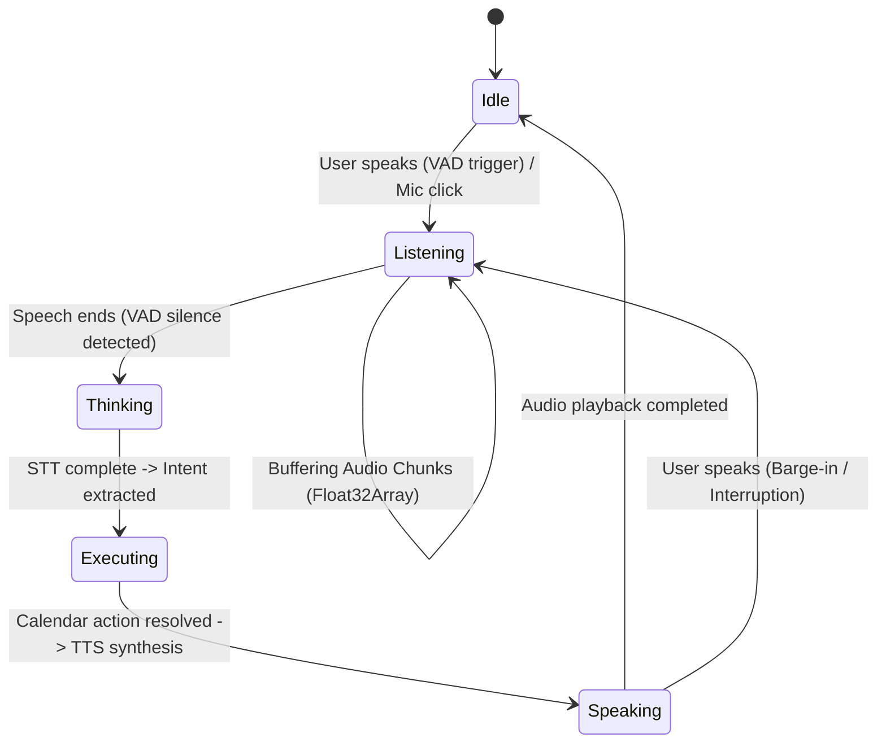
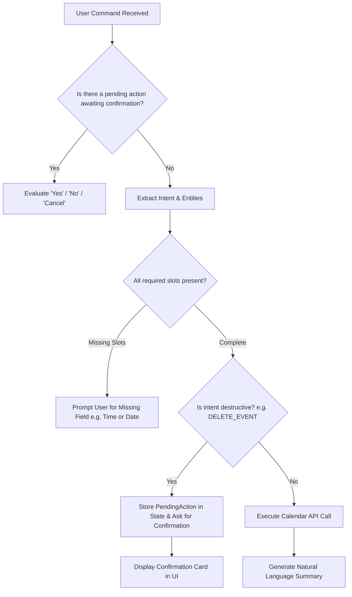

# Voice Calendar Agent - System Architecture

## 1. Executive Summary & Architectural Overview

The **Voice Calendar Agent** is a privacy-conscious, low-latency desktop assistant designed to manage Google Calendar through multimodal interactions (natural language text and voice). Built on **Electron**, **React 19**, and **TypeScript**, the system enforces strict architectural boundaries: privileged system tasks, OAuth credentials, and calendar communication reside entirely in the **Node.js Main Process**, while user interface interactions, visual feedback, and audio capture/VAD execute within the sandboxed **React Renderer Process**.



---

## 2. Component Deep Dive: The 15 Architectural Pillars

### 2.1 Electron Desktop Architecture

The application adopts the Electron multi-process security model:

1. **Process Isolation**:
   - **Main Process**: Holds Node.js runtime, handles OS lifecycle, secure storage, OAuth 2.0 loopback server, Google API communication, and LLM orchestration.
   - **Renderer Process**: Pure Chromium browser environment with `contextIsolation: true`, `nodeIntegration: false`, and `sandbox: true`. No Node.js APIs or secret keys are accessible.
   - **Preload Script**: Selective, strictly typed bridge exposing only designated methods via `contextBridge.exposeInMainWorld`.

2. **Single Instance & Window Lifecycle**:
   - Single-instance lock via `app.requestSingleInstanceLock()`. If a secondary instance is launched, focus returns to the primary window.
   - Window behavior: Closing the main window intercepts the event and hides the window to the system tray (`event.preventDefault(); mainWindow.hide();`) rather than terminating the Node.js runtime.
   - Graceful termination occurs only via the System Tray context menu ("Quit") or explicit IPC command.

3. **Security Directives & Content Security Policy (CSP)**:
   - Renderer HTML enforces a strict CSP restricting script execution to self-bundled assets and disabling inline scripts:
     ```html
     <meta
       http-equiv="Content-Security-Policy"
       content="default-src 'self'; script-src 'self'; style-src 'self' 'unsafe-inline'; img-src 'self' data: https:; connect-src 'self' ws: http: https:;"
     />
     ```
   - Navigation lock: External links trigger `shell.openExternal(url)` and deny in-app navigation (`setWindowOpenHandler`).

---

### 2.2 React Renderer Architecture

The frontend is built using React 19 and standard modern CSS (no heavyweight utility frameworks), focused on high-performance rendering, responsive feedback, and micro-interactions.

```
src/renderer/src/
├── assets/                  # CSS tokens, theme variables, icons
│   ├── base.css             # Typography, reset, design tokens
│   └── main.css             # Component-level styles
├── components/
│   ├── AssistantAvatar.tsx  # Dynamic status orb (idle, listening, thinking, speaking)
│   ├── ChatFeed.tsx         # Conversation history & assistant message bubbles
│   ├── EventCard.tsx        # Calendar event confirmation & preview card
│   ├── CommandInput.tsx     # Text input box with shortcut hints
│   ├── AudioVisualizer.tsx  # Waveform/amplitude visualizer driven by AudioContext
│   ├── SettingsModal.tsx    # OAuth connection status & provider settings
│   └── StatusBar.tsx        # Connection status, active timezone, mode
├── hooks/
│   ├── useCalendarAgent.ts  # Primary interaction hook (messages, status, sendCommand)
│   ├── useVoiceRecorder.ts  # Web Audio API + VAD lifecycle hook
│   └── useAudioPlayback.ts  # Audio player for TTS output with barge-in support
├── stores/
│   └── agentStore.ts        # Lightweight UI state store (messages, status, errors)
├── types/
│   └── renderer.d.ts        # UI-specific view model types
├── App.tsx                  # Root shell layout
└── main.tsx                 # React DOM mount point
```

#### Decoupling Rule

In compliance with `AGENTS.md`, **all business logic resides outside React components**. React components solely dispatch user actions to typed hooks and subscribe to agent state updates via typed event emitters.

---

### 2.3 Preload and IPC Architecture

Communication across the isolated boundary is strictly typed and unidirectional or request-response based.

```
Renderer (UI)  ====[ window.calendarAgentApi ]====>  Preload Script  ====[ ipcRenderer.invoke / on ]====>  Main Process (IPC Router)
```

#### Typed IPC Contract Definition

```typescript
// Shared IPC contract definitions
export interface CalendarEventDTO {
  id: string
  summary: string
  description?: string
  location?: string
  start: { dateTime?: string; date?: string; timeZone?: string }
  end: { dateTime?: string; date?: string; timeZone?: string }
  status?: string
  htmlLink?: string
}

export interface AgentCommandRequest {
  text: string
  source: 'text' | 'voice'
  clientTimestamp: string
  timeZone: string
}

export interface AgentCommandResponse {
  success: boolean
  message: string
  intent: string
  events?: CalendarEventDTO[]
  requiresConfirmation?: boolean
  confirmationPayload?: unknown
  error?: string
}

export interface AuthStatusDTO {
  isAuthenticated: boolean
  userEmail?: string
  scopes: string[]
}

// Preload Exposed Interface
export interface CalendarAgentAPI {
  // Authentication
  getAuthStatus: () => Promise<AuthStatusDTO>
  loginWithGoogle: () => Promise<AuthStatusDTO>
  logout: () => Promise<void>

  // Agent Commands (Milestone 1 MVP)
  executeCommand: (request: AgentCommandRequest) => Promise<AgentCommandResponse>

  // Calendar Direct Query (Optional helper)
  listUpcomingEvents: (maxResults?: number) => Promise<CalendarEventDTO[]>

  // Streaming & Events
  onAgentStatusChange: (
    callback: (status: 'idle' | 'listening' | 'thinking' | 'speaking') => void
  ) => () => void
  onStreamToken: (callback: (token: string) => void) => () => void
}
```

#### Secure Error Sanitization

Exceptions originating in the Main process are sanitized before being serialized across IPC to prevent prototype pollution or inadvertent leakage of credentials, tokens, or system file paths.

---

### 2.4 Google Calendar OAuth 2.0 Architecture

Google deprecates embedded webviews for OAuth (Loopback IP flow is mandated by RFC 8252 for native apps).



#### Security Directives for Token Storage

- Plaintext tokens are **never** stored on disk.
- Tokens are encrypted using Electron's `safeStorage` API:
  - Windows: DPAPI (Data Protection API)
  - macOS: Keychain Services
  - Linux: Secret Service API / Libsecret
- Tokens are refreshed automatically by `google-auth-library` before expiration. When refreshed, the new token set is encrypted and re-persisted.

---

### 2.5 Google Calendar Service Subsystem

The Calendar Service encapsulates all interaction with Google's Calendar v3 REST API.

```typescript
export interface ICalendarService {
  initialize(): Promise<boolean>
  listEvents(timeMin: string, timeMax: string, query?: string): Promise<CalendarEventDTO[]>
  createEvent(event: CreateEventParams): Promise<CalendarEventDTO>
  updateEvent(eventId: string, patch: UpdateEventParams): Promise<CalendarEventDTO>
  deleteEvent(eventId: string): Promise<boolean>
  findFreeBusy(timeMin: string, timeMax: string): Promise<TimeSlot[]>
}
```

#### Error Handling & Resilience

- **401 Unauthorized**: Automatically attempts token refresh via OAuth2Client; if refresh token is expired or revoked, signals `auth:required` state to the UI.
- **403 Rate Limited / Quota**: Exponential backoff with jitter (initial retry 500ms, max 3 retries).
- **Timezone Normalization**: All time values submitted to and received from Google Calendar are normalized to ISO-8601 with explicit timezone offsets using `Luxon`.

---

### 2.6 Intent and Entity Extraction

The natural language engine transforms arbitrary user queries into structured calendar operations:

```
"Move my 3pm meeting tomorrow with Bob to 4:30pm"
                  │
                  ▼
┌────────────────────────────────────────────────────────┐
│ Intent: UPDATE_EVENT                                   │
│ TargetQuery: "meeting with Bob"                         │
│ OriginalTime: 2026-10-02T15:00:00+07:00                 │
│ NewTime: 2026-10-02T16:30:00+07:00                      │
│ Duration: 60 minutes (inferred from original event)    │
└────────────────────────────────────────────────────────┘
```

#### Taxonomy of Supported Intents

1. `CREATE_EVENT`: Booking meetings, focus time, appointments, reminders.
2. `LIST_EVENTS`: Inspecting schedule for a given date, range, or keyword.
3. `UPDATE_EVENT`: Shifting start times, changing summaries, adding attendees.
4. `DELETE_EVENT`: Removing or cancelling scheduled appointments.
5. `CHECK_AVAILABILITY`: Querying free/busy blocks ("Am I free tomorrow afternoon?").
6. `CONFIRM_ACTION`: Responding to pending confirmations ("Yes, proceed").
7. `REJECT_ACTION`: Cancelling a pending action ("No, don't delete that").
8. `UNKNOWN_QUERY`: General fallback / clarification prompt.

#### Schema Enforcement with Gemini Structured Outputs

Using `@google/genai`, the prompt leverages JSON Schema mode to guarantee response shape without hallucinated fields:

```typescript
export interface ExtractedCalendarIntent {
  intent:
    | 'CREATE_EVENT'
    | 'LIST_EVENTS'
    | 'UPDATE_EVENT'
    | 'DELETE_EVENT'
    | 'CHECK_AVAILABILITY'
    | 'UNKNOWN'
  confidence: number
  summary?: string
  description?: string
  location?: string
  attendees?: string[]
  timeRange?: {
    startDateTime?: string // ISO 8601
    endDateTime?: string // ISO 8601
    dateOnly?: string // YYYY-MM-DD for all-day events
  }
  searchCriteria?: {
    query?: string
    timeMin?: string
    timeMax?: string
  }
  updateFields?: {
    newSummary?: string
    newStartDateTime?: string
    newEndDateTime?: string
  }
  clarificationNeeded?: string
}
```

---

### 2.7 Date and Time Reasoning Engine

Natural language date parsing is notoriously prone to hallucination without strict contextual grounding.

```
User Query: "Schedule lunch with Sarah next Tuesday at noon"
                           │
  [Context Injector] ──────┼────────────────────────────────────────┐
                           │                                        │
                           ▼                                        ▼
             Reference Local Time Anchor               Chrono-Node Deterministic Check
             Time: 2026-10-01T23:04:50+07:00           Parsed: 2026-10-06T12:00:00+07:00
             Day: Thursday                             Ref Date: 2026-10-01
             Timezone: Asia/Ho_Chi_Minh
                           │
                           ▼
             LLM Temporal Reasoning Prompt
                           │
                           ▼
             Luxon Validator & Formatter
             Final Start: 2026-10-06T12:00:00+07:00
             Final End:   2026-10-06T13:00:00+07:00 (default 60m)
```

#### Key Rules for Time Grounding

1. **Always Anchor With Current Time**: Every prompt must supply `CURRENT_ISO_TIMESTAMP`, `LOCAL_TIMEZONE`, and `DAY_OF_WEEK`.
2. **Deterministic Dual-Verification**:
   - Primary: LLM structured output grounded with prompt anchor.
   - Secondary / Validation: `chrono-node` executes deterministic parsing on date strings to verify that relative words ("tomorrow", "in 3 days") match the LLM's computed ISO dates.
3. **Implicit Duration Resolution**: If start time is specified without an end time:
   - Lunch / Dinner: Default 60 minutes.
   - Quick sync / Call / Coffee: Default 30 minutes.
   - Unspecified: Default 30 minutes.

---

### 2.8 Voice Pipeline Architecture

The end-to-end voice loop operates as a stateful audio pipeline:



1. **Audio Capture**: 16kHz mono PCM via Web Audio API `AudioWorklet` in the Renderer.
2. **Barge-in (Interruption Support)**: When the agent is in the `Speaking` state, if the VAD detects new speech above the confidence threshold, the TTS playback is immediately aborted via `window.speechSynthesis.cancel()` or audio buffer stop, and the state transitions back to `Listening`.

---

### 2.9 Voice Activity Detection (VAD)

Integrated via `@ricky0123/vad-web` paired with `onnxruntime-web` (WebAssembly execution):

- **Model**: Silero VAD (ONNX model executed locally in Renderer).
- **Execution**: Runs in a dedicated Web Audio worklet off the main React thread.
- **Parameters**:
  - `positiveSpeechThreshold`: `0.75` (high confidence to avoid background noise triggers).
  - `negativeSpeechThreshold`: `0.35` (hysteresis floor for speech continuation).
  - `minSpeechFrames`: `5` (filters out keyboard clicks and momentary spikes).
  - `redemptionFrames`: `8` (~250ms of trailing silence before triggering speech completion).
- **Output**: Returns raw 16kHz Float32 audio segments packaged into WAV buffers.

---

### 2.10 Speech-to-Text (STT) Subsystem

The STT subsystem defines a pluggable interface:

```typescript
export interface ISpeechToTextProvider {
  readonly id: string
  transcribe(audioWavBuffer: Buffer): Promise<string>
  isAvailable(): Promise<boolean>
}
```

- **Cloud Provider**: Google Gemini Multimodal Audio API or Whisper API. Fast, high-accuracy, handles accented speech and vocabulary context (calendar terms).
- **Local Fallback Provider**: Whisper.cpp or ONNX transformer running locally on CPU/DirectML, enabling offline speech recognition.

---

### 2.11 Text-to-Speech (TTS) Subsystem

The TTS subsystem converts the agent's textual response into natural audio:

```typescript
export interface ITextToSpeechProvider {
  readonly id: string
  synthesize(text: string): Promise<ArrayBuffer | string> // Audio data or WebSpeech utterance
  cancel(): void
}
```

- **Tier 1 (Built-in Zero-Latency)**: Chromium `window.speechSynthesis` (Web Speech API). Instantaneous startup, no external network requests, zero cost.
- **Tier 2 (Neural Cloud Voice)**: Google Cloud Text-to-Speech / ElevenLabs streaming synthesis for lifelike conversational agents.

---

### 2.12 Conversation State and Slot Filling

The Conversation Manager tracks session context and supports multi-turn slot filling and confirmation for destructive actions:



#### Pending Action Contract

```typescript
export interface PendingAction {
  id: string
  type: 'DELETE_EVENT' | 'UPDATE_EVENT' | 'BULK_ACTION'
  eventId: string
  eventSummary: string
  originalData?: CalendarEventDTO
  newData?: Partial<CalendarEventDTO>
  expiresAt: number // Timestamp after which confirmation lapses
}
```

---

### 2.13 Streaming Architecture

While Milestone 1 uses standard request-response execution, the architecture is designed to support streaming from day one:

```
[LLM Token Stream]
       │
       ├───> IPC Event: 'agent:token' ───> React UI (Live Markdown Typing Effect)
       │
       └───> Sentence Boundary Buffer ───> As soon as regex matches ([.!?\n]), dispatch chunk to TTS
```

- **Sentence-based Audio Chunking**: By segmenting text at punctuation marks before passing to TTS, the first audio playback can begin in under 400ms, long before the LLM finishes generating the final paragraph.

---

### 2.14 Local vs Cloud AI Abstraction Layer

All AI capabilities are behind strict behavioral interfaces:

```typescript
export interface ILanguageModelProvider {
  readonly providerId: string
  extractIntentAndEntities(prompt: string, context: AgentContext): Promise<ExtractedCalendarIntent>
  generateResponse(prompt: string, context: AgentContext): Promise<string>
}

export interface AgentContext {
  currentTimeIso: string
  timeZone: string
  recentHistory: ConversationMessage[]
  activePendingAction?: PendingAction
}
```

- **GeminiProvider**: Implements `ILanguageModelProvider` using `@google/genai` (Gemini 2.5 Flash / 1.5 Pro).
- **OllamaProvider**: Implements `ILanguageModelProvider` pointing to a local Ollama instance (e.g., Llama 3.2 3B or Qwen 2.5 7B) using native JSON schema validation.

---

### 2.15 System Tray and Background Mode

Desktop utility agents must be accessible without taking up persistent screen real estate:

1. **System Tray Lifecycle**:
   - An icon resides in the Windows Notification Area / System Tray (`resources/icon.png`).
   - Context Menu:
     - Open Assistant
     - Quick Schedule...
     - Re-authenticate Calendar
     - Status: Connected (user@gmail.com)
     - Quit
2. **Global Hotkey Summon**:
   - Electron `globalShortcut.register('CommandOrControl+Shift+Space', ...)` summons or hides the agent window.
   - The window behaves as a quick floating assistant (centered or bottom-right flyout).
3. **Native Notifications**:
   - Event creation, updates, and upcoming calendar notifications are dispatched via Electron's `Notification` module.

---

## 3. Data Flow Diagram: Milestone 1 (Minimal Working Prototype)

Milestone 1 explicitly bypasses voice, wake-words, and streaming to validate the core deterministic pipeline:

```
User types text command in React UI
       │
       ▼
window.calendarAgentApi.executeCommand({ text, clientTimestamp, timeZone })
       │  (IPC: 'calendar:execute-command')
       ▼
Main Process: AgentOrchestrator
       │
       ├──> Injects current system time & timezone into prompt
       │
       ├──> LanguageModelProvider (Gemini / JSON Schema mode)
       │       └── Parses Intent, Entities, Dates
       │
       ├──> Date Validator (Luxon & Chrono verify time bounds)
       │
       ├──> CalendarService (Google Calendar API v3)
       │       └── Executes list / insert / patch / delete
       │
       └──> Formulates clear natural language response + event DTOs
       │
       ▼
IPC Return -> React UI updates chat feed & renders Event Preview Card
```

---

## 4. Security & Compliance Matrix

| Threat Vector                          | Mitigation Strategy                                                                                                                 |
| -------------------------------------- | ----------------------------------------------------------------------------------------------------------------------------------- |
| **Exfiltration of OAuth Tokens**       | Tokens encrypted via OS `safeStorage` (DPAPI/Keychain). Never accessible to Renderer or logged to console.                          |
| **XSS / Malicious Event Descriptions** | Strict CSP in renderer; React auto-escaping for HTML entities; sanitized rendering for event descriptions.                          |
| **Accidental Event Deletion**          | Destructive intents (`DELETE_EVENT`) require explicit user confirmation through UI interaction.                                     |
| **Rate Limiting & Quotas**             | Exponential backoff with jitter on 429/403 responses from Google APIs.                                                              |
| **Loopback Hijacking**                 | OAuth 2.0 loopback server selects a random ephemeral port and verifies a cryptographically secure random `state` token on callback. |
