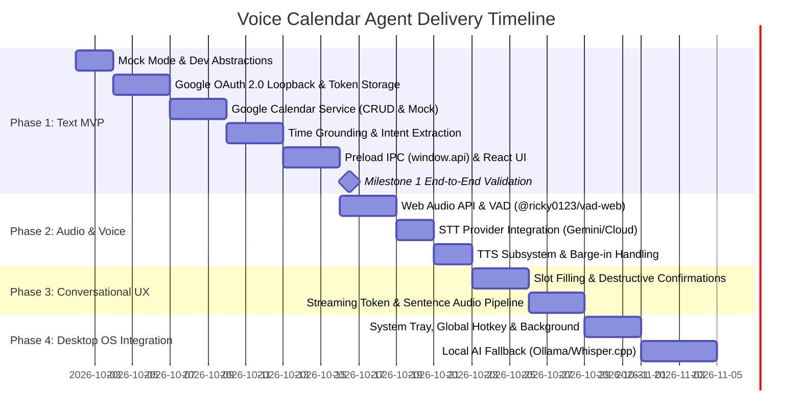

# Voice Calendar Agent - Implementation Plan

## Overview & Development Strategy

In accordance with [AGENTS.md](file:///d:/DATT/voice-calendar-agent/AGENTS.md), this project is developed strictly through incremental, testable milestones.

> [!IMPORTANT]
> **Milestone 1 Priority**: The initial delivery focuses exclusively on the **Minimal Working Prototype (Text MVP)**:
> $$\text{User (Text Input)} \longrightarrow \text{Intent / Entity Extraction} \longrightarrow \text{Google Calendar Subsystem} \longrightarrow \text{Formatted Result}$$
> Voice activity detection (VAD), speech-to-text (STT), text-to-speech (TTS), wake-word detection, streaming, and background mode are deferred to subsequent phases.

---

## 1. Roadmap & Milestone Summary

---

## 2. Milestone 1: Minimal Working Prototype (Detailed Breakdown)

### Goal

Provide a fully functioning desktop application where the user can connect their Google Calendar (or use Mock Dev Mode), type natural language commands (e.g., _"Schedule team sync tomorrow at 2pm"_, _"What do I have on Friday?"_, _"Cancel my dental checkup tomorrow"_), and observe the operation executed on their live Google Calendar (or mock store) with instant UI confirmation.

---

### Step 0: Mock Mode & Development Fallbacks (Zero-Config Testing)

#### Objectives

Allow instant testing of the entire Milestone 1 flow without requiring pre-configured Google Cloud Console projects or Gemini API keys.

#### File Blueprint

- [src/main/calendar/mockCalendarService.ts](file:///d:/DATT/voice-calendar-agent/src/main/calendar/mockCalendarService.ts):
  - In-memory implementation of `ICalendarService` seeded with 3-5 realistic calendar events.
  - Supports instant CRUD testing offline.
- [src/main/agent/ruleBasedExtractor.ts](file:///d:/DATT/voice-calendar-agent/src/main/agent/ruleBasedExtractor.ts):
  - Deterministic fallback using `chrono-node` and keyword matching (e.g., "schedule", "create", "what do I have", "cancel", "delete").
  - Ensures the app runs even if `GEMINI_API_KEY` is not yet set.

---

### Step 1: Secure Credential Management & OAuth 2.0 Loopback

#### Objectives

1. Implement native desktop OAuth 2.0 with loopback redirect using `google-auth-library`.
2. Securely store refresh and access tokens on disk using Electron's native `safeStorage`.
3. Provide safe fallback when `safeStorage.isEncryptionAvailable()` returns false (e.g. certain Linux / dev environments).

#### File Blueprint

- [src/main/auth/tokenStore.ts](file:///d:/DATT/voice-calendar-agent/src/main/auth/tokenStore.ts):
  - Encrypts/decrypts OAuth credentials via `safeStorage.encryptString()` / `safeStorage.decryptString()`.
  - Checks `safeStorage.isEncryptionAvailable()`; logs clear warnings in non-secure dev mode.
  - Persists binary data to `app.getPath('userData')/auth_tokens.bin`.
- [src/main/auth/oauthManager.ts](file:///d:/DATT/voice-calendar-agent/src/main/auth/oauthManager.ts):
  - Creates ephemeral local HTTP server bound strictly to `127.0.0.1:0` (never `0.0.0.0`).
  - Auto-shuts down server after a 2-minute timeout if user cancels or closes browser.
  - Generates cryptographically secure `state` parameter to protect against CSRF.
  - Generates Google OAuth URL with scopes:
    - `https://www.googleapis.com/auth/calendar.events`
    - `https://www.googleapis.com/auth/calendar.readonly`
    - `https://www.googleapis.com/auth/userinfo.email`
  - Launches user's default browser via `shell.openExternal()`.
  - Captures callback code, verifies `state`, exchanges for tokens, stores encrypted payload, and terminates HTTP server.
  - Automatically refreshes tokens before expiration via `OAuth2Client`.

---

### Step 2: Google Calendar Service Layer

#### Objectives

Implement an isolated, typed calendar service implementing a shared interface.

#### File Blueprint

- [src/main/calendar/calendarTypes.ts](file:///d:/DATT/voice-calendar-agent/src/main/calendar/calendarTypes.ts):
  - Domain models for `CalendarEvent`, `CreateEventInput`, `UpdateEventInput`, `EventFilterParams`.
  - `ICalendarService` interface definition.
- [src/main/calendar/googleCalendarService.ts](file:///d:/DATT/voice-calendar-agent/src/main/calendar/googleCalendarService.ts):
  - Implements `ICalendarService`.
  - `listEvents(timeMin: string, timeMax: string, q?: string)`: queries `calendar.events.list`.
  - `createEvent(input: CreateEventInput)`: executes `calendar.events.insert`.
  - `updateEvent(eventId: string, patch: UpdateEventInput)`: executes `calendar.events.patch`.
  - `deleteEvent(eventId: string)`: executes `calendar.events.delete`.
  - `findEventByQuery(summaryOrDate: string)`: helper to locate specific events for edit/cancellation.

---

### Step 3: Date/Time Grounding & Intent/Entity Extraction

#### Objectives

Extract structured calendar operations from raw text, grounded in the user's real-time local date and timezone.

#### File Blueprint

- [src/main/agent/timeGrounding.ts](file:///d:/DATT/voice-calendar-agent/src/main/agent/timeGrounding.ts):
  - Determines local timezone (e.g. `Intl.DateTimeFormat().resolvedOptions().timeZone`).
  - Prepares ISO timestamp anchors (`DateTime.now().setZone(tz).toISO()`).
  - Uses `chrono-node` as a deterministic local validation pass.
- [src/main/agent/intentExtractor.ts](file:///d:/DATT/voice-calendar-agent/src/main/agent/intentExtractor.ts):
  - Uses `@google/genai` (Gemini 2.5 Flash) with structured JSON Schema output.
  - Falls back to `ruleBasedExtractor.ts` when no API key is provided.
  - Prompt schema extracts:
    - `intent`: `CREATE_EVENT` | `LIST_EVENTS` | `UPDATE_EVENT` | `DELETE_EVENT` | `UNKNOWN`
    - `summary`: title of event
    - `startIso`: ISO 8601 formatted start time
    - `endIso`: ISO 8601 formatted end time
    - `attendees`: array of emails/names
    - `targetQuery`: for updates/deletions (e.g., "dentist")
- [src/main/agent/agentOrchestrator.ts](file:///d:/DATT/voice-calendar-agent/src/main/agent/agentOrchestrator.ts):
  - Coordinates Intent Extraction -> Calendar Service (Google or Mock) -> Natural Language Response formatting.

---

### Step 4: IPC Layer & Preload Alignment

#### Objectives

Align directly with electron-vite's established `window.api` structure in `src/preload/index.ts` and `src/preload/index.d.ts`.

#### File Blueprint

- [src/main/ipc/registerCalendarIpc.ts](file:///d:/DATT/voice-calendar-agent/src/main/ipc/registerCalendarIpc.ts):
  - Validates IPC input arguments at runtime before passing to services.
  - Registers handlers with `ipcMain.handle`:
    - `auth:get-status`
    - `auth:login`
    - `auth:logout`
    - `agent:execute-command`
    - `calendar:list-upcoming`
- [src/preload/index.ts](file:///d:/DATT/voice-calendar-agent/src/preload/index.ts):
  - Populates the existing `api` object exposed via `contextBridge.exposeInMainWorld('api', api)`.
  - Exposes typed methods: `api.getAuthStatus()`, `api.login()`, `api.executeCommand()`, etc.
- [src/preload/index.d.ts](file:///d:/DATT/voice-calendar-agent/src/preload/index.d.ts):
  - Extends `interface Window { api: CalendarAgentAPI }` with complete TypeScript signatures.

---

### Step 5: React Renderer Minimal Working UI

#### Objectives

A clean, responsive interface to authenticate, view connection status, type commands, view interactive response cards, and view upcoming events.

#### File Blueprint

- [src/renderer/src/stores/agentStore.ts](file:///d:/DATT/voice-calendar-agent/src/renderer/src/stores/agentStore.ts):
  - Simple reactive store for `messages`, `authStatus`, and `isProcessing`.
- [src/renderer/src/components/StatusBar.tsx](file:///d:/DATT/voice-calendar-agent/src/renderer/src/components/StatusBar.tsx):
  - Displays authentication state (e.g. `Connected: user@gmail.com` or `Mock Mode`), active timezone, and connection toggle.
- [src/renderer/src/components/ChatFeed.tsx](file:///d:/DATT/voice-calendar-agent/src/renderer/src/components/ChatFeed.tsx):
  - Renders user prompt bubbles and assistant response bubbles.
- [src/renderer/src/components/EventCard.tsx](file:///d:/DATT/voice-calendar-agent/src/renderer/src/components/EventCard.tsx):
  - Visual summary card for created, listed, or modified calendar events (Title, Date/Time, Location, Link to Google Calendar).
- [src/renderer/src/components/CommandInput.tsx](file:///d:/DATT/voice-calendar-agent/src/renderer/src/components/CommandInput.tsx):
  - Text input with auto-focus and keyboard shortcut support (`Enter` to send).
- [src/renderer/src/components/SettingsModal.tsx](file:///d:/DATT/voice-calendar-agent/src/renderer/src/components/SettingsModal.tsx):
  - Configure Google Client ID / Secret and Gemini API Key if not using `.env`, with toggle for "Use Mock Calendar".
- [src/renderer/src/App.tsx](file:///d:/DATT/voice-calendar-agent/src/renderer/src/App.tsx):
  - Assembles the UI shell with a polished dark theme layout.

---

### Milestone 1 Acceptance Criteria & Verification Matrix

| Test Case          | User Input                                     | Expected Result                                                                    |
| ------------------ | ---------------------------------------------- | ---------------------------------------------------------------------------------- |
| **Mock Mode Flow** | Click "Use Mock Calendar"                      | Instantly connects to in-memory store; no Google account required                  |
| **Auth Connect**   | Click "Connect Google Calendar"                | System browser opens, consent given, app shows "Connected as user@example.com"     |
| **Schedule Event** | _"Schedule lunch with Sarah tomorrow at 12pm"_ | Creates event on Calendar for tomorrow 12:00-13:00, renders EventCard              |
| **List Schedule**  | _"What's on my calendar for Friday?"_          | Lists all events scheduled for that day in chronological order                     |
| **Update Event**   | _"Move my lunch tomorrow to 1pm"_              | Locates the lunch event, patches start/end to 13:00-14:00, confirms change         |
| **Delete Event**   | _"Cancel my lunch tomorrow"_                   | Deletes event from Calendar and confirms cancellation                              |
| **Ambiguous Time** | _"Set up meeting with Dave"_                   | Assistant responds: _"What day and time should I schedule the meeting with Dave?"_ |
| **Auth Expiry**    | Token expired during request                   | Automatically refreshes using refresh token without user disruption                |

---

## 3. Milestone 2: Voice Pipeline & Audio Subsystem

_(Executed after Milestone 1 is verified)_

1. **Web Audio Capture & VAD (`@ricky0123/vad-web`)**:
   - Initialize Mic Stream in React Renderer via `navigator.mediaDevices.getUserMedia()`.
   - Run Silero VAD in WebAssembly worker.
   - Dispatch `onSpeechStart` (transition UI to `Listening`) and `onSpeechEnd` (package Float32 audio into 16kHz WAV).
2. **Speech-to-Text (STT)**:
   - Send audio buffer to Main process via IPC (`stt:transcribe`).
   - Process audio using Gemini 2.5 multimodal audio endpoint or Whisper API.
   - Feed transcribed string directly into `agentOrchestrator.executeCommand()`.
3. **Text-to-Speech (TTS) & Barge-In**:
   - Synthesize assistant reply using Web Speech API `window.speechSynthesis` or Cloud TTS.
   - Listen for VAD interrupt: if user speaks during playback, immediately call `speechSynthesis.cancel()`.

---

## 4. Milestone 3: Streaming & Conversational State

_(Executed after Milestone 2)_

1. **Token Streaming**:
   - Stream Gemini output tokens across IPC `agent:stream-token` to animate markdown response.
2. **Sentence-Boundary Audio Chunking**:
   - Punctuation regex buffer (`/[.?!]\s+/`) passes complete sentences to TTS immediately, achieving sub-500ms time-to-first-audio.
3. **Slot Filling & Destructive Confirmation State Machine**:
   - Explicit confirmation card for deletions: _"Are you sure you want to delete Team Standup on Oct 3?"_ (`[Yes, Delete] / [Cancel]`).

---

## 5. Milestone 4: Desktop Ergonomics & Background Mode

_(Executed after Milestone 3)_

1. **System Tray Integration**:
   - Tray icon in Windows taskbar tray with quick status and context menu.
   - Window close event minimizes to tray instead of quitting.
2. **Global Hotkey Summon**:
   - Register `CommandOrControl+Shift+Space` to summon floating voice command palette.
3. **Native Reminders**:
   - Periodic background check for events starting in <10 minutes, generating native Windows desktop notifications.

---

## 6. Milestone 5: Local/Cloud AI Abstraction & Packaging

1. **Pluggable AI Backends**:
   - Switch between Cloud (Gemini) and Local (Ollama + local Whisper) in Settings.
2. **Production Packaging**:
   - Validate `electron-builder` configuration for Windows (`build:win`), signing, and portable distribution.

---

## 7. Immediate Next Steps to Begin Milestone 1

1. Create `.env.example` defining `GOOGLE_CLIENT_ID`, `GOOGLE_CLIENT_SECRET`, and `GEMINI_API_KEY`.
2. Implement [src/main/calendar/calendarTypes.ts](file:///d:/DATT/voice-calendar-agent/src/main/calendar/calendarTypes.ts) and [src/main/calendar/mockCalendarService.ts](file:///d:/DATT/voice-calendar-agent/src/main/calendar/mockCalendarService.ts).
3. Implement [src/main/auth/tokenStore.ts](file:///d:/DATT/voice-calendar-agent/src/main/auth/tokenStore.ts) using `safeStorage` (with `isEncryptionAvailable` check).
4. Implement [src/main/auth/oauthManager.ts](file:///d:/DATT/voice-calendar-agent/src/main/auth/oauthManager.ts) with loopback server and `state` validation.
5. Implement [src/main/calendar/googleCalendarService.ts](file:///d:/DATT/voice-calendar-agent/src/main/calendar/googleCalendarService.ts).
6. Implement [src/main/agent/intentExtractor.ts](file:///d:/DATT/voice-calendar-agent/src/main/agent/intentExtractor.ts) with `ruleBasedExtractor.ts` fallback.
7. Wire IPC in [src/main/ipc/registerCalendarIpc.ts](file:///d:/DATT/voice-calendar-agent/src/main/ipc/registerCalendarIpc.ts) and expose via [src/preload/index.ts](file:///d:/DATT/voice-calendar-agent/src/preload/index.ts) under `window.api`.
8. Build the Text MVP UI in `src/renderer/src/App.tsx`.
